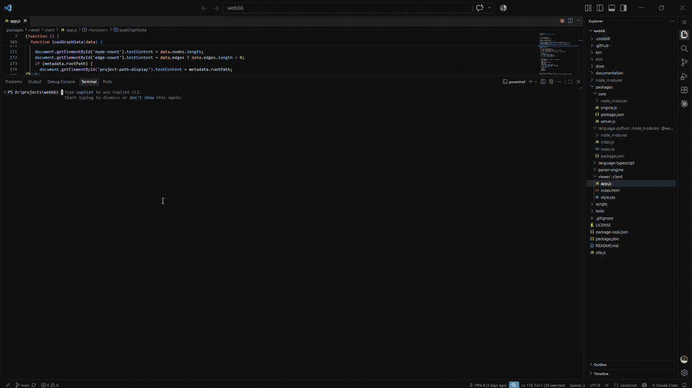

# Code68 🚀
### Autonomous AI Coding Agent | Cloud Intelligence + Local Execution

[](https://prn-6.github.io/code68/)
[](LICENSE)
[](https://www.python.org/downloads/)
[]()

<p align="center">
  
</p>

Code68 is an independent, modular open-source terminal AI coding agent inspired by Claude Code.

**The Core Concept:**
> **Cloud Intelligence + Local Execution = Code68**
>
> The heavy LLM (e.g., `Qwen/Qwen2.5-Coder-7B-Instruct`, 4-bit quantized) runs remotely on a GPU server (such as a free Kaggle instance with 2x NVIDIA Tesla T4 GPUs), while Code68 runs locally on the developer's computer. The local agent interacts with your real project files, terminal, Git repository, and tests with full security sandboxing and granular permissions. The local computer never needs to load the model into memory.

---

## 🏗️ Architecture

```
                                      CLOUD (Remote GPU / Kaggle / vLLM)
                             ┌──────────────────────────────────────────────────┐
                             │   Qwen2.5-Coder-7B-Instruct (4-bit BitsAndBytes) │
                             │        OpenAI-Compatible FastAPI Server          │
                             │          Token Auth + SSE Streaming              │
                             └────────────────────────┬─────────────────────────┘
                                                      ▲  Encrypted Tunnel
                                                      │  (Cloudflare / ngrok)
                                                      ▼
LOCAL DEVELOPER MACHINE      ┌──────────────────────────────────────────────────┐
                             │                  Code68 CLI                      │
                             │  ┌─────────────────────────────────────────────┐ │
                             │  │            Autonomous Agent Loop            │ │
                             │  │      (Tool Calling, Loop Detector, Context) │ │
                             │  └──────────────┬──────────────────────────────┘ │
                             │                 │                                │
                             │                 ▼                                │
                             │  ┌─────────────────────────────────────────────┐ │
                             │  │           Security & Sandbox Gate           │ │
                             │  │  (Permission Levels, Traversal Guard, Audit)│ │
                             │  └──────────────┬──────────────────────────────┘ │
                             │                 │ Approved Actions               │
                             │                 ▼                                │
                             │  ┌─────────────────────────────────────────────┐ │
                             │  │               Local Tools                   │ │
                             │  │  • Filesystem (read, write, edit with diff) │ │
                             │  │  • Search (ripgrep / python fallback)       │ │
                             │  │  • Terminal (sandboxed commands & timeouts) │ │
                             │  │  • Git (status, diff, branch, safe commit)  │ │
                             │  │  • Testing (pytest, linters, type checkers) │ │
                             │  └─────────────────────────────────────────────┘ │
                             └──────────────────────────────────────────────────┘
```

---

## ⚡ Key Features

- **Real Tool-Calling Agent Loop**: Autonomous multi-step problem solving, loop detection, and structured tool recovery.
- **Surgical Code Editing**: Uses unified diffs and snippet replacement rather than blindly rewriting entire files.
- **Deep Codebase Intelligence**: AST symbol extraction, language discovery, `.gitignore` filtering, and smart token budgeting.
- **Strict Security & Boundaries**:
  - Traversal prevention (`resolve_safe_path` confines access to project root).
  - 5 Granular permission levels: `read-only`, `edit-approved`, `auto-edit`, `command-approved`, and `full-auto`.
  - Destructive command interceptor (`rm -rf`, disk wipes, fork bombs blocked).
  - Secret & API key redaction in logs and tool results.
  - Full audit logging in `.code68/audit.log`.
- **Provider Agnostic**: Seamlessly swap between Kaggle, vLLM, Ollama, OpenRouter, or OpenAI without changing any client code.
- **Beautiful Rich Terminal UI**: Markdown formatting, syntax highlighting, diff visualizer, and streaming token output.

---

## 📦 Installation

### Method 1: Install Directly via pip (Quickest for Users ⚡)

Any developer with Python 3.11+ can install Code68 as a system-wide or user tool:

```bash
# Using pip
pip install git+https://github.com/PRN-6/code68.git

# Or isolated using pipx (recommended for CLI apps)
pipx install git+https://github.com/PRN-6/code68.git
```

Now `code68` is available everywhere in your terminal:
```bash
code68 --version
```

### Method 2: Clone for Local Development / Contributing

```bash
# Clone the repository
git clone https://github.com/PRN-6/code68.git
cd code68

# Create and activate virtual environment
python -m venv .venv
source .venv/bin/activate  # On Windows: .\.venv\Scripts\activate

# Install in editable mode with development dependencies
pip install -e ".[dev]"
```

---

## ☁️ Setting Up an LLM Brain

Code68 needs an LLM endpoint. Users can choose **any** of the following options:

### Option A: Free Cloud GPU via Kaggle (Zero Local VRAM)

1. Open a new Kaggle notebook: [kaggle.com/code](https://www.kaggle.com/code)
2. Settings (right panel): Accelerator = **GPU T4 x 2**, Internet = **ON**
3. Paste and run this single cell:
   ```python
   !git clone https://github.com/PRN-6/code68.git
   %cd /kaggle/working/code68
   !pip install -q -r server/requirements-server.txt
   !python server/kaggle_server.py
   ```
4. Copy the printed tunnel URL into your `.env` file:
   ```env
   CODE68_BASE_URL=https://random-name.trycloudflare.com/v1
   CODE68_API_KEY=code68-secret-key
   ```

### Option B: Local Ollama (100% Offline)

If a user already has [Ollama](https://ollama.com/) installed locally:
```bash
ollama run qwen2.5-coder:7b
```
Then configure Code68:
```env
CODE68_BASE_URL=http://localhost:11434/v1
CODE68_MODEL=qwen2.5-coder:7b
```

### Option C: Cloud API (OpenRouter, DeepSeek, Groq, OpenAI)

Code68 works with any OpenAI-compatible provider:
```env
CODE68_BASE_URL=https://openrouter.ai/api/v1
CODE68_API_KEY=your-openrouter-key
CODE68_MODEL=qwen/qwen-2.5-coder-32b-instruct
```

---

## ⚙️ Configuration

Configure via environment variables or `.env`:

```env
CODE68_BASE_URL=https://your-cloud-endpoint/v1
CODE68_API_KEY=code68-secret-key
CODE68_MODEL=Qwen/Qwen2.5-Coder-7B-Instruct
CODE68_PROVIDER=openai-compatible
CODE68_PERMISSION_LEVEL=edit-approved
```

Or configure via the CLI:
```bash
code68 config --set-url "https://your-endpoint/v1" --set-key "your-key"
```

Check system diagnostics:
```bash
code68 doctor
```

---

## 💻 CLI Usage

### Interactive REPL
```bash
code68
```
Inside the interactive session:
- Type your instructions naturally: `Find bugs in auth.py and fix them`
- Interactive slash commands:
  - `/help` - Show available commands
  - `/clear` - Clear conversation context
  - `/compact` - Compact message history to stay within token budget
  - `/model [name]` - View or switch model
  - `/status` - Check server connection & workspace state
  - `/diff` - View current uncommitted git diff
  - `/undo` - Revert changes
  - `/exit` - Exit Code68

### One-shot Command Execution
```bash
code68 "Analyze the architecture of this project and summarize main entrypoints"
```

---

## 🛡️ Security & Permission Levels

Configure safety constraints with `CODE68_PERMISSION_LEVEL`:

| Level | Allowed Without Prompting | Requires Confirmation |
|---|---|---|
| `read-only` | File reads, directory listing, searching, git status | File modifications, terminal commands, deletions |
| `edit-approved` (Default) | Reads, searches, git status | File edits, file deletions, commands |
| `auto-edit` | File edits, reads, searches | Terminal commands, deletions |
| `command-approved` | Edits, reads, searches | Terminal commands |
| `full-auto` | All operations within workspace | None (unattended automation) |

*Note: Destructive commands (e.g. `rm -rf /`, `mkfs`) and deletions are always flagged regardless of permission level.*

---

## 🧪 Testing

Run the full automated test suite (mocked provider, tools, security, indexing, and CLI):

```bash
pytest -v
```

---

## 📂 Project Structure

```
code68/
│
├── pyproject.toml              # Package specifications & entry points
├── requirements.txt            # Dependency specifications
├── README.md                   # Complete documentation
├── LICENSE                     # MIT License
├── .env.example                # Sample environment configuration
│
├── server/                     # Cloud Inference Server
│   ├── kaggle_server.py        # 4-bit Qwen2.5-Coder server with Cloudflare tunnel
│   └── README.md               # Kaggle deployment guide
│
├── src/code68/
│   ├── __init__.py
│   ├── main.py                 # Executable entrypoint
│   ├── cli.py                  # Typer CLI & interactive REPL
│   │
│   ├── core/                   # Agent Architecture
│   │   ├── agent.py            # High-level coordinator
│   │   ├── agent_loop.py       # Tool-calling agent loop with loop detection
│   │   ├── context.py          # Dynamic workspace context builder
│   │   ├── conversation.py     # Conversation thread & token manager
│   │   ├── planner.py          # Multi-step task planner
│   │   ├── state.py            # Agent state & repetitive loop detector
│   │   └── prompts.py          # System prompt & behavioral principles
│   │
│   ├── llm/                    # Remote Inference Layer
│   │   ├── base.py             # Abstract base provider & exceptions
│   │   ├── client.py           # Provider factory
│   │   ├── models.py           # Message, ToolCall, FunctionCall models
│   │   ├── providers.py        # OpenAI-compatible & Mock providers
│   │   └── streaming.py        # SSE chunk accumulator
│   │
│   ├── tools/                  # Local Execution Tools
│   │   ├── registry.py         # Tool registry, permission dispatcher & audit logger
│   │   ├── schemas.py          # OpenAI function schema generator
│   │   ├── filesystem.py       # Safe read, write, edit_file (diff), list, delete
│   │   ├── search.py           # ripgrep integration with Python regex fallback
│   │   ├── terminal.py         # Subprocess runner with timeouts & safety filters
│   │   ├── git.py              # Git status, diff, log, show, safe commit
│   │   └── testing.py          # Automated test, linter, & type checker runner
│   │
│   ├── indexing/               # Codebase Intelligence
│   │   ├── ignore.py           # .gitignore filter
│   │   ├── scanner.py          # Project & language detection
│   │   ├── symbols.py          # Python AST symbol extractor
│   │   └── retrieval.py        # Visual ASCII tree & relevant file finder
│   │
│   ├── security/               # Security & Sandboxing
│   │   ├── permissions.py      # Granular permission levels
│   │   ├── sandbox.py          # Workspace boundary & traversal guard
│   │   └── validation.py       # Destructive command detector & secret masking
│   │
│   ├── storage/                # State & Persistence
│   │   ├── config.py           # Pydantic configuration loader
│   │   ├── history.py          # Conversation history & context compactor
│   │   └── sessions.py         # Session persistence to disk
│   │
│   └── ui/                     # Terminal Interface
│       ├── terminal.py         # Terminal UI coordinator
│       ├── renderer.py         # Rich markdown, diffs, panels, & status
│       └── components.py       # Approval dialogs & user prompts
│
└── tests/                      # Automated Test Suite (27 tests)
    ├── conftest.py             # Fixtures (workspace & mock LLM)
    ├── test_agent.py           # End-to-end tool calling & agent loop tests
    ├── test_cli.py             # CLI commands tests
    ├── test_indexing.py        # Codebase scanner, symbols, & tree tests
    ├── test_llm.py             # LLM provider, streaming, & schema tests
    ├── test_security.py        # Sandbox traversal & permission tests
    └── test_tools.py           # Filesystem, search, terminal, & git tests
```

---

## 📜 License

MIT License. See [LICENSE](LICENSE) for details.

